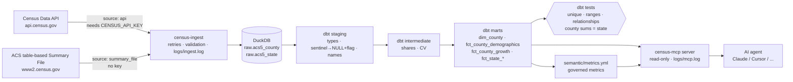

# census-pipeline

**US Census ACS data → DuckDB → tested dbt models → governed metrics → a read-only MCP server AI agents can query safely.**

<p>
  <a href="LICENSE"></a>
  
  
  
  
  
</p>

Scope today: **Florida (state FIPS 12), 67 counties + the state total**, ACS 5-year vintages, with
population, median household income, median age and Hispanic / race counts, each with its margin of error.
Scaling to all 50 states is a config change (`geography.states` in `config.yaml`).

## What it does

- **Ingests** ACS 5-year data from the Census Data API (key) or the official ACS Summary File (no key), with retries, backoff and quality gates (row counts, columns, duplicate GEOIDs, parse rate) before anything is loaded.
- **Loads idempotently** into DuckDB: each (year, state) is replaced atomically, never duplicated.
- **Transforms and tests** with dbt: sentinel codes → `NULL` + flag (nothing silently dropped), CVs for reliability, growth only across non-overlapping windows, and a reconciliation test that the 67 counties sum to the state total.
- **Governs metrics** in `semantic/metrics.yml` (formula, grain, caveats) and compiles them to parameterized SQL.
- **Serves agents** through a read-only MCP server: `list_tables`, `describe_table`, `run_query`, `list_metrics`, `get_metric`, every call logged.

## Architecture



## Folder structure

```
census-pipeline/
├── config.yaml                 # WHAT to pull: source, years, states, variables, retries, validation
├── pyproject.toml / uv.lock    # dependencies (uv); mcp pinned <2 (FastMCP API)
├── src/
│   ├── census_ingest/
│   │   ├── client.py           # Census Data API client: retries + backoff, key handling, JSON parsing
│   │   ├── summary_file.py     # no-key fallback: official ACS Summary File reshaped to API rows
│   │   ├── validate.py         # quality gates before load (row count, columns, dup geoids, parse rate)
│   │   ├── load.py             # idempotent raw load (delete+insert per year/state, load metadata)
│   │   └── cli.py              # `census-ingest` entry point, logging to logs/ingest.log
│   └── census_mcp/
│       ├── metrics.py          # metrics.yml -> parameterized SQL
│       └── server.py           # FastMCP server: list_tables, describe_table, run_query, list_metrics, get_metric
├── dbt/
│   ├── dbt_project.yml         # vars: acs_variables (mirror of config.yaml), tolerance
│   ├── profiles.yml.example    # copy to profiles.yml (gitignored)
│   ├── macros/acs.sql          # sentinel handling, safe_growth, shared staging columns
│   ├── tests/generic/          # accepted_range, county_sum_matches_state, unique combo
│   └── models/
│       ├── staging/            # sources.yml (+freshness), stg_acs__county, stg_acs__state
│       ├── intermediate/       # int_acs__county_enriched
│       └── marts/              # dim_county, fct_county_demographics, fct_county_growth, fct_state_demographics, fct_state_growth
├── semantic/metrics.yml        # governed metric definitions (formula, grain, caveats)
├── scripts/mcp_demo.py         # drives the MCP server over stdio, writes examples/agent_queries.md
├── examples/agent_queries.md   # real tool calls + real outputs
├── tests/                      # pytest: ingestion parsing, MCP safety, metrics
├── data/  logs/                # created at runtime (gitignored)
└── LICENSE (MIT)
```

## Setup

```bash
# 1. install uv (https://docs.astral.sh/uv/) then:
uv sync

# 2. Census API key (free): https://api.census.gov/data/key_signup.html
#    The key must be ACTIVATED via the link in the signup email.
cp .env.example .env        # put CENSUS_API_KEY=... in .env (gitignored) or export it

# 3. dbt profile
cp dbt/profiles.yml.example dbt/profiles.yml
```

## Run everything end to end

```bash
# Ingest (all years in config.yaml) from the API ...
uv run census-ingest
# ... or, without a working key, from the official Summary File (2019, 2021+ only):
uv run census-ingest --source summary_file --years 2019 2024

# Transform + test + docs
cd dbt
uv run dbt build --profiles-dir .            # models + all tests
uv run dbt source freshness --profiles-dir .
uv run dbt docs generate --profiles-dir .    # then: uv run dbt docs serve --profiles-dir .
cd ..

# Python tests
uv run pytest -q

# MCP server (stdio). Exercise it like an agent and regenerate the examples:
uv run python scripts/mcp_demo.py
```

Use with an MCP client (e.g. Claude Desktop `claude_desktop_config.json`):

```json
{"mcpServers": {"census": {"command": "uv", "args": ["--directory", "/path/to/census-pipeline", "run", "census-mcp"]}}}
```

Re-running ingestion is safe: each (year, state) is replaced atomically, never duplicated.

On Windows, clone to a local folder such as `C:\dev\census-pipeline` (keep projects out of OneDrive-synced folders) and run the same `uv` commands in PowerShell.

## AI / agent angle

`census-mcp` gives an agent governed metrics and a guarded, read-only SQL tool instead of raw tables, so answers come from tested marts.
`scripts/mcp_demo.py` drives the server over stdio like an agent would and records the real tool calls and outputs in
[`examples/agent_queries.md`](examples/agent_queries.md). `tests/test_mcp_safety.py` covers the query guard.

## Key concepts (read these before changing things)

* **Sentinel codes.** The Census encodes "no value" as numbers like `-666666666`. Staging turns them into
  `NULL` and keeps the code in `<metric>_flag`, so nothing is lost and nothing is miscounted.
  County population and race/ethnicity counts are *controlled* estimates, so their MOE is `-555555555` → `NULL`.
* **MOE.** ACS numbers are survey estimates with 90% margins of error (`*_moe`). `median_household_income_cv`
  flags unreliable estimates (CV > 0.30).
* **Overlapping windows.** ACS 2024 covers 2020-2024, ACS 2019 covers 2015-2019. Only compare
  non-overlapping vintages; growth tables mark this with `windows_non_overlapping`.
* **Medians don't add up.** State medians come from the official state row, never from county math.
* **Reconciliation test.** `county_sum_matches_state` proves the 67 counties sum to the official state total.

## Next steps

* Get the API key activated and add vintage 2014 (2010-2014; only available via the API, not the table-based Summary File).
* All 50 states: list every FIPS in `geography.states` (+ expected county counts).
* Inflation-adjust incomes (CPI-U-RS) for real growth; add MOE of ratios/derived values.
* Expose dbt docs as MCP resources; add an orchestrator (cron / GitHub Actions / Dagster).
* Add more tables (B01001 age bands, B17001 poverty, B25077 home values).

## Tech stack

Python · uv · requests · DuckDB · dbt-duckdb · YAML semantic layer · MCP Python SDK (FastMCP) · pytest

## Disclaimer

ACS figures are survey **estimates** with margins of error. This is a data-engineering demonstration for learning and testing; outputs are not official Census Bureau statistics and should be checked against [data.census.gov](https://data.census.gov) before any real use.

## Credits

- **Data:** U.S. Census Bureau, American Community Survey 5-year estimates, via the [Census Data API](https://www.census.gov/data/developers.html) and the [ACS Summary File](https://www.census.gov/programs-surveys/acs/data/summary-file.html). U.S. federal government works are public domain. *This product uses the Census Bureau Data API but is not endorsed or certified by the Census Bureau.*
- **Software:** [DuckDB](https://duckdb.org) (MIT), [dbt-core](https://github.com/dbt-labs/dbt-core) / [dbt-duckdb](https://github.com/duckdb/dbt-duckdb) (Apache-2.0), [MCP Python SDK](https://github.com/modelcontextprotocol/python-sdk) (MIT), [requests](https://requests.readthedocs.io) (Apache-2.0), [PyYAML](https://pyyaml.org) (MIT), [python-dotenv](https://github.com/theskumar/python-dotenv) (BSD-3-Clause), [pytest](https://pytest.org) (MIT), [uv](https://docs.astral.sh/uv/) (MIT/Apache-2.0). Each keeps its own license.

## License

Code: MIT, see [LICENSE](LICENSE).
